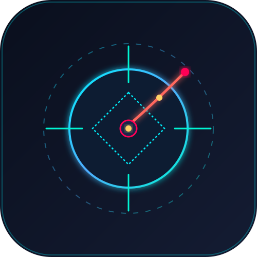

<div align="center">



# ScopeCreep.ai
### AI-Powered Sprint Watchdog Detecting Silent Scope Creep Against Locked PRDs

[](LICENSE)
[](frontend/)
[](backend/)
[](#)

<p align="center">
  <b>An AI-powered sprint watchdog that continuously compares developer communication and code commits against approved PRD baselines to catch silent scope creep before release deadlines slip.</b>
</p>

</div>

---

---

## 🚀 Live Deployments
* **Frontend (Vercel)**: [https://scopecreep-ai.vercel.app](https://scopecreep-ai.vercel.app)
* **Backend (Render)**: `https://scopecreep-ai.onrender.com`

---

## 🛠️ System Workflow

```
[PRD Baseline Context] ──→ [Dev Chat / Commits] ──→ [AI Delta Engine] ──→ [Creep Alerts Feed]
   (PM input baseline)        (Developer updates)       (Gemini evaluation)      (HIGH/MEDIUM/LOW pills)
```

1. **Lock Baseline**: The PM locks the approved PRD scope context.
2. **Simulate Chat**: Developer communication or commit messages are ingested.
3. **AI Delta-Evaluation**: The AI compared the inputs and flags any features outside the locked scope.
4. **Escalate/Dismiss**: The PM reviews and either dismisses (false positive) or escalates (notifies Slack).

---

## 💻 Tech Stack
* **Frontend**: React 19 · Vite 8 · Tailwind CSS v4 · Framer Motion 12 · Lucide Icons
* **Backend**: Node.js (Express) · `@google/genai` (Gemini API SDK)
* **AI Model**: Gemini 3.5 Flash
* **Telemetry**: Pendo Web SDK & Novus.ai Telemetry

---

## ⚡ Quick Start (Local Setup)

### 1. Prerequisites & Environment
Create a `.env` file in the project root:
```env
PORT=3000
GEMINI_API_KEY=your_gemini_api_key_here
```

### 2. Run the Backend
```bash
cd backend
pnpm install
npm start # Starts server at http://localhost:3000
```
*(If no API Key is provided, the backend falls back to high-fidelity mock scenario evaluations).*

### 3. Run the Frontend
```bash
cd frontend
pnpm install
npm run dev # Starts Vite server at http://localhost:5173
```

---

## 📊 Telemetry Events (Novus.ai / Pendo)
The dashboard instruments custom client-side analytics trackers on key PM actions:

| Event Name | Trigger | Captured Metadata |
|---|---|---|
| `PRD Baseline Established` | PM locks the PRD scope | `charCount`, `wordCount` |
| `Scope Analysis Completed` | Successful AI evaluation | `is_scope_creep`, `severity`, `alert_id` |
| `Alert Dismissed` | PM dismisses a false positive alert | `severity`, `alertId`, `alert_age_ms` |
| `Alert Escalated` | PM dispatches alert for Slack mitigation | `severity`, `duration_ms` (time-to-act) |